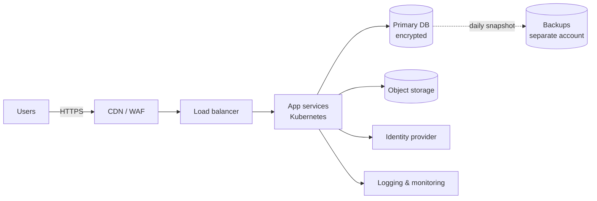
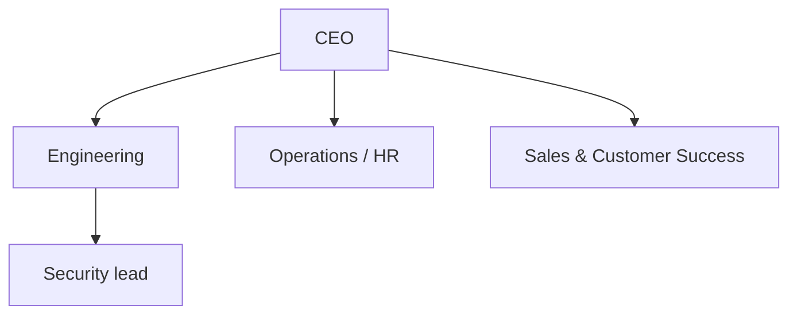
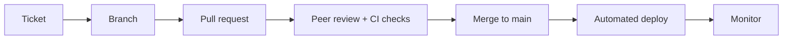

# Organization context templates

SOC2Start stores five context sections via `updateOrganizationContext` (`product`, `architecture`, `team`, `processes`, `customers`). Each is markdown. Mermaid code blocks render as diagrams.

Rules:
- Framework-neutral. Describe the company, not the controls.
- Scope to the system in audit scope.
- Facts only. Mark unknowns as `TBD — <question>` in the draft you show the user, and resolve them before saving.
- `getOrganizationContext` first; merge with what's there instead of overwriting.

---

## 1. Product

Ask: What do you sell? Who uses it? How is it delivered (SaaS, on-prem, API, mobile)? What data does it handle? Which environments exist?

```markdown
## Product overview
<Company> provides <product>, a <delivery model> that helps <users> <outcome>.

## In-scope system
- Name: <product / service names in audit scope>
- Delivery: <multi-tenant SaaS | single-tenant | self-hosted | API>
- Environments: production, staging, development

## Key capabilities
- <capability 1>
- <capability 2>

## Data handled
| Data | Source | Sensitivity |
|---|---|---|
| Customer account data | Sign-up | Confidential |
| Customer content | Uploaded by users | Confidential |

## Out of scope
- <products, internal tools or side projects not in scope>
```

## 2. Architecture

Ask: Cloud provider and regions? Compute (Kubernetes, serverless, VMs)? Datastores? Identity provider? CI/CD? Logging/monitoring? Backups? Encryption? Network boundaries? Read IaC or architecture docs if available.

````markdown
## Hosting
<Cloud>, region(s) <regions>. Infrastructure defined in <Terraform/CDK/…>.

## Diagram


## Components
| Component | Technology | Notes |
|---|---|---|
| Compute | | |
| Database | | encryption at rest: |
| Identity | | MFA enforced: |
| CI/CD | | |
| Monitoring / logging | | retention: |
| Backups | | frequency, retention, restore test: |

## Security boundaries
- Network: <VPC layout, public vs private subnets>
- Encryption in transit: <TLS version>; at rest: <KMS / provider-managed>
- Admin access: <bastion, SSO, break-glass>
````

## 3. Team

Ask: Headcount and roles? Contractors? Who owns security, engineering, HR, IT? Where are people located? How are people onboarded/offboarded? Background checks?

````markdown
## Organization
<N> employees and <N> contractors across <locations>.



## Key roles
| Role | Person / team | Responsibilities |
|---|---|---|
| Security / compliance owner | | Policies, risk, audit |
| Engineering lead | | Change management, access to production |
| People / HR | | Onboarding, offboarding, background checks |
| IT | | Devices, SaaS accounts |

## Contractors
<How contractors are engaged, what they can access, agreements in place>
````

## 4. Processes

Ask: How do code changes reach production? How is access granted and removed? How are incidents handled? Vendors approved? Backups tested? Devices managed? What cadences exist (access reviews, risk review, training)?

````markdown
## Change management

- Branch protection: <yes/no, rules>
- Who can deploy to production: <roles>

## Access management
- Joiner: <steps, approvals, tools>
- Mover: <steps>
- Leaver: <steps, time to revoke>
- Access reviews: <cadence, owner>

## Incident response
<How incidents are detected, triaged, escalated, communicated, reviewed>

## Vendor management
<How new vendors are approved and reviewed>

## Recurring activities
| Activity | Cadence | Owner |
|---|---|---|
| Access review | Quarterly | |
| Risk assessment | Annual | |
| Security training | Annual + onboarding | |
| Backup restore test | | |
| Policy review | Annual | |
````

## 5. Customers

Ask: Customer types and sizes? Industries? Regions? Contractual commitments (SLA, DPA, security questionnaires)? What do customers ask for (SOC 2 report, pen test, ISO)?

```markdown
## Customer profile
- Segments: <SMB / mid-market / enterprise>
- Industries: <…>
- Regions: <…>

## Commitments
- SLA: <uptime target, support response>
- DPA / privacy terms: <standard DPA, subprocessors list>
- Security commitments in contracts: <encryption, breach notification within N hours, …>

## Customer assurance requests
<What customers request during sales/security reviews>
```
